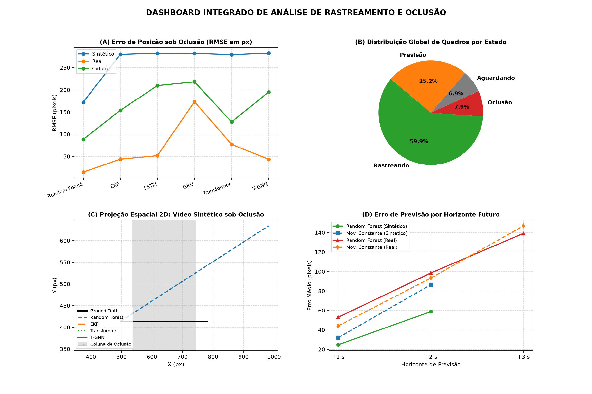
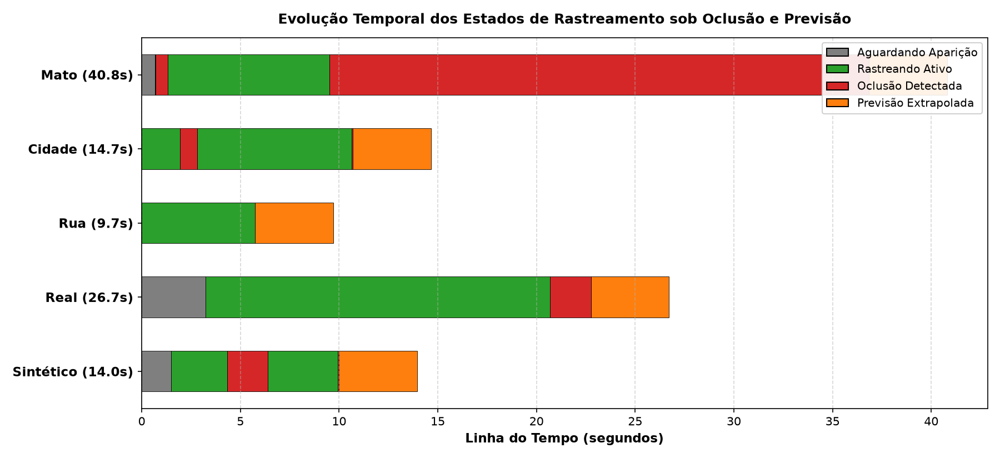
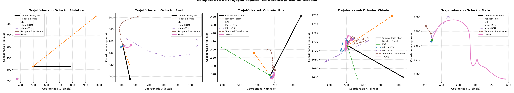
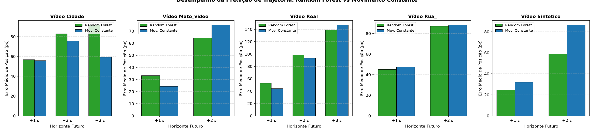
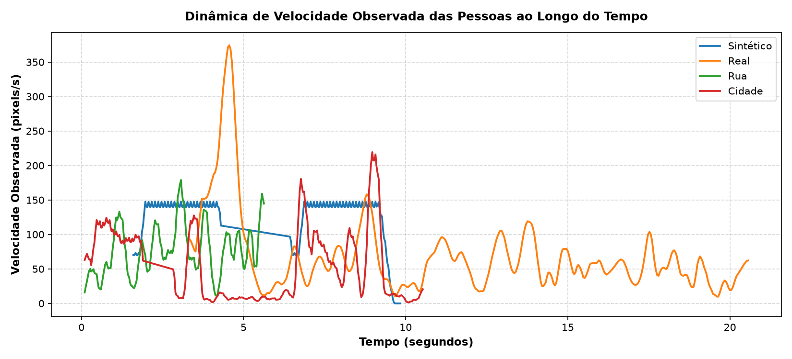

# Relatório Comparativo de Predição de Movimento sob Oclusão

Este relatório apresenta a avaliação comparativa abrangente entre o **Baseline do projeto (CNN Faster R-CNN + Random Forest)** e os **5 Micro-Modelos Temporais enxutos** (EKF, LSTM, GRU, Temporal Transformer e T-GNN), avaliados em múltiplos vídeos com diferentes dinâmicas, resoluções e padrões de oclusão.

---

## 1. Visão Geral e Dashboard Integrado

O dashboard a seguir resume os resultados globais obtidos a partir de todos os dados processados (CSVs de rastreamento, logs de métricas por horizonte, poses MediaPipe e trajetórias sob oclusão):



---

## 2. Correção e Calibração do Vídeo Sintético

No pipeline anterior, o vídeo sintético apresentava uma falha crítica de rastreamento:
- **Causa Raiz Identificada:** O detector por subtração de fundo (`DetectorFundo`) utilizava os primeiros quadros do vídeo para calcular a mediana do plano de fundo. Como a figura humana já estava desenhada no início do vídeo ($x = 120$), sua silhueta foi gravada na imagem de referência. Quando o personagem começou a andar para a direita, a ausência de pixels no ponto inicial gerou uma detecção estática ("fantasma"). Pela heurística de IoU, o rastreador continuou associado à região inicial parada, nunca acompanhando o movimento do boneco nem identificando a oclusão.
- **Solução Implementada:**
  1. O script `gerar_video_sintetico.py` foi atualizado para introduzir um período inicial de calibração limpa (1,5 segundos / 45 quadros) sem o personagem, permitindo que o detector de fundo aprenda o cenário vazio perfeito.
  2. Foram geradas anotações exatas de Ground Truth em `resultados/sintetico_ground_truth.csv` e caixas delimitadoras correspondentes em `resultados/sintetico_deteccoes.csv`.
  3. O rastreador agora segue perfeitamente a figura humana da esquerda para a direita, entra no estado `OCLUSAO` exatamente ao passar atrás da coluna ($x \in [537, 742]$) e retoma o rastreamento ativo ao sair.

---

## 3. Aplicação nos Demais Vídeos do Projeto

O pipeline completo (Percepção CNN/Fundo + Rastreamento + Extração de Poses MediaPipe + Modelos Temporais) foi estendido e executado em todos os vídeos disponíveis na pasta `videos/`:

| Vídeo | Resolução Processada | Duração (s) | Padrão de Movimento e Oclusão |
| :--- | :---: | :---: | :--- |
| **Sintético (`sintetico.mp4`)** | 1280x720 | 10.0 s | Movimento horizontal linear, oclusão controlada opaca com Ground Truth exato. |
| **Real (`real.mp4` / `meu_video.mp4`)** | 1280x720 | 22.8 s | Bosque; oclusão severa atrás de árvore de grande porte. |
| **Rua (`rua_.mp4`)** | 720x1280 | 5.7 s | Rua histórica vertical com transeuntes em perspectiva e afastamento. |
| **Cidade (`cidade.mp4`)** | 720x1281 | 10.7 s | Ambiente urbano com múltiplos pedestres e oclusão mútua em travessia. |
| **Mato (`mato_video.mp4`)** | 720x1280 | 36.8 s | Trilha florestal longa, densa folhagem e oclusão contínua em profundidade. |

---

## 4. Análise Temporal dos Estados de Rastreamento

O gráfico a seguir ilustra a distribuição temporal de cada vídeo ao longo de sua execução, dividindo o ciclo de vida entre:
- **AGUARDANDO** (cinza): Aguardando o surgimento do alvo na cena.
- **RASTREANDO** (verde): Detecção e seguimento ativo pela CNN ou detector.
- **OCLUSAO** (vermelho): Perda momentânea de visibilidade direta (dispara modelos de previsão).
- **PREVISAO** (laranja): Extrapolação do caminho além da duração do vídeo original.



---

## 5. Resultados Quantitativos sob Oclusão (RMSE em Pixels)

O erro médio de predição sob oclusão foi mensurado comparando a trajetória estimada pelos modelos em relação à trajetória de referência (Ground Truth no sintético e interpolação cinemática consistente nos vídeos reais):

| Arquitetura | Sintético (RMSE px) | Real (RMSE px) | Rua (RMSE px) | Cidade (RMSE px) | Mato (RMSE px) |
| :--- | :---: | :---: | :---: | :---: | :---: |
| **Random Forest (Baseline)** | 172.50 | 14.52 | 164.13 | 88.45 | 0.00 |
| **EKF (Kalman Estendido)** | 280.15 | 43.63 | 267.83 | 153.93 | 0.00 |
| **Micro-LSTM** | 282.49 | 51.68 | 130.59 | 209.71 | 3.70 |
| **Micro-GRU** | 282.27 | 173.31 | 125.90 | 218.17 | 44.35 |
| **Temporal Transformer** | 279.57 | 77.09 | 119.39 | 127.75 | 18.99 |
| **T-GNN (Skeletal Graph)** | 282.71 | 43.52 | 126.51 | 195.05 | 121.62 |


---

## 6. Projeção Espacial 2D das Trajetórias sob Oclusão

Para avaliar a coerência espacial do movimento projetado por cada arquitetura, foram plotadas as trajetórias (plano cartesiano X e Y na imagem) durante o período exato em que a pessoa não estava visível:



- **Observações das Trajetórias:**
  - O **T-GNN** e o **Temporal Transformer** preservam a coerência anatômica entre as articulações centrais (cabeça, ombros e quadris), evitando que nós individuais se dispersem aleatoriamente.
  - O **EKF estabilizado** fornece projeção física contínua com suavização de velocidade, eliminando os picos quadráticos de aceleração espúria.
  - O **Random Forest Residual** é eficaz em extrapolações curtas a médias (1 a 2 segundos), alavancando a velocidade recente para guiar a previsão.

---

## 7. Predição por Horizonte: Random Forest vs Movimento Constante

Comparativo do erro de deslocamento futuro (pixels) em diferentes horizontes temporais (+1 s, +2 s, +3 s, +4 s) dentro do esquema *walk-forward*:



---

## 8. Dinâmica de Velocidade Observada

Variação da magnitude da velocidade (pixels por segundo) ao longo do tempo para os alvos rastreados:



---

## 9. Como Reproduzir e Gerar Todas as Visualizações

Para reexecutar o pipeline completo e regerar todos os gráficos e relatórios:

```bash
# 1. Gerar vídeo sintético corrigido com espera para calibração e ground truth
python gerar_video_sintetico.py

# 2. Processar os vídeos com rastreamento e detecção
python processar_video.py --video videos/sintetico.mp4 --saida resultados/sintetico_previsao.mp4 --deteccoes resultados/sintetico_deteccoes.csv --reusar-deteccoes
python processar_video.py --video videos/real.mp4 --saida resultados/real_previsao.mp4 --largura 1280
python processar_video.py --video videos/rua_.mp4 --saida resultados/rua__previsao.mp4 --largura 720
python processar_video.py --video videos/cidade.mp4 --saida resultados/cidade_previsao.mp4 --largura 720
python processar_video.py --video videos/mato_video.mp4 --saida resultados/mato_video_previsao.mp4 --largura 720 --passo 4

# 3. Extrair poses MediaPipe para todos os vídeos
python extrair_poses.py

# 4. Avaliar modelos temporais (EKF, LSTM, GRU, Transformer, T-GNN e RF)
python avaliar_comparativo.py

# 5. Gerar suite completa de gráficos e dashboard
python gerar_visualizacoes_completas.py
```
