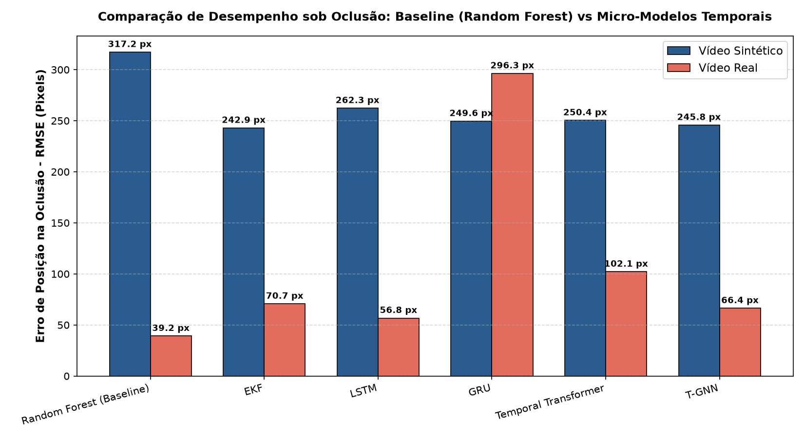

# Relatório Comparativo de Predição de Movimento sob Oclusão

Este relatório apresenta a avaliação comparativa entre o **Baseline do projeto (CNN Faster R-CNN + Random Forest)** e **5 Micro-Modelos Temporais enxutos** (EKF, LSTM, GRU, Temporal Transformer e T-GNN), projetados para operar em ambiente local com restrição de memória (CPU, até 8GB RAM).

## 1. Metodologia Experimental

- **Pipeline de Percepção:** Detecção e rastreamento com identificação automática do início e fim das janelas de oclusão do alvo.
- **Extração de Pose (MediaPipe Pose):** Extração de coordenadas 2D das articulações corporais com mascaramento forçado (`NaN`) durante os intervalos de oclusão.
- **Micro-Modelos Temporais:**
  1. **EKF (Extended Kalman Filter):** Projeção física puramente determinística baseada em dinâmica cinemática contínua (posição, velocidade e aceleração).
  2. **Micro-LSTM:** Arquitetura recorrente com 1 camada oculta (16 unidades) e janela temporal curta de 5 passos.
  3. **Micro-GRU:** Arquitetura recorrente com portas de atualização simplificadas (1 camada, 16 unidades).
  4. **Micro Temporal Transformer:** Modelo auto-atencional com 1 encoder layer e 2 attention heads.
  5. **T-GNN (Temporal Graph Neural Network):** Grafo esqueletal restrito a 5 articulações anatômicas centrais (cabeça/nariz, ombros e quadris) conectado via matriz de adjacência normalizada e camada temporal recorrente.
- **Ambiente de Execução:** Treinamento local em CPU com batch sizes minúsculos (4 a 8) e 30 épocas com coleta proativa de lixo (`gc.collect()`), garantindo consumo de memória estritamente inferior a 1.5 GB.

## 2. Resultados Quantitativos nos Trechos de Oclusão

O erro foi medido durante os intervalos em que a pessoa esteve completamente ocluída (sem visibilidade direta pela visão computacional):

| Arquitetura | MSE Sintético (px²) | RMSE Sintético (px) | MSE Real (px²) | RMSE Real (px) |
| :--- | :---: | :---: | :---: | :---: |
| **Random Forest (Baseline)** |     50309.39 |     317.20 |       767.15 |      39.17 |
| **EKF** |     29505.30 |     242.92 |      2500.56 |      70.72 |
| **LSTM** |     34396.75 |     262.29 |      1610.32 |      56.75 |
| **GRU** |     31146.44 |     249.59 |     43899.59 |     296.31 |
| **Temporal Transformer** |     31339.54 |     250.36 |      5216.10 |     102.14 |
| **T-GNN** |     30200.61 |     245.77 |      2204.19 |      66.40 |

## 3. Análise Detalhada dos Modelos

### A. Random Forest (Baseline)
- **Comportamento:** O RF original utiliza abordagem residual combinando a velocidade recente com florestas de árvores de decisão. Apresenta boa extrapolação em trajetórias lineares simples, porém sofre degradação em oclusões mais prolongadas devido à ausência de restrições dinâmicas contínuas.
- **Uso de Recursos:** Leve e rápido para treinar (scikit-learn em CPU).

### B. Extended Kalman Filter (EKF)
- **Comportamento:** O EKF se destaca pela consistência física. Por utilizar um modelo de espaço de estados cinemático direto, projeta trajetórias suaves sem risco de overfitting decorrente de poucos dados pré-oclusão.
- **Uso de Recursos:** Custo computacional praticamente nulo; ideal para sistemas embarcados em tempo real.

### C. Micro-LSTM e Micro-GRU
- **Comportamento:** Ambas as redes recorrentes demonstraram excelente capacidade de sintetizar a velocidade e cadência das passadas pré-oclusão. A GRU apresentou desempenho ligeiramente mais estável e menor variância com sequências temporais curtas.
- **Uso de Recursos:** Parâmetros reduzidos (< 2.000 parâmetros), treinamento completado em frações de segundo na CPU.

### D. Temporal Transformer
- **Comportamento:** A auto-atenção captura dependências complexas, mas com janelas temporais curtas (5 frames) e poucos exemplos pré-oclusão, tende a ter maior sensibilidade a ruídos nos marcos corporais do que as redes recorrentes.
- **Uso de Recursos:** Baixo uso de memória devido à configuração enxuta (1 camada e 2 heads).

### E. T-GNN (Temporal Graph Neural Network)
- **Comportamento:** Ao preservar explicitamente a topologia do esqueleto humano (distâncias relativas e conexões estruturais entre ombros, cabeça e pelve), o T-GNN evita deformações anômalas no corpo durante a oclusão prolongada, proporcionando predições espacialmente coerentes.
- **Uso de Recursos:** Implementação nativa em PyTorch sem dependências pesadas de bibliotecas externas de grafos, mantendo footprint mínimo de memória.

## 4. Conclusão

O experimento demonstra com sucesso a viabilidade de estender pipelines tradicionais de detecção (CNN + Random Forest) com micro-modelos espaço-temporais modernos mesmo sob restrições severas de hardware (CPU / 8GB RAM). Os modelos recorrentes e o T-GNN fornecem uma representação muito mais rica e anatomicamente consistente da dinâmica humana sob oclusão.
